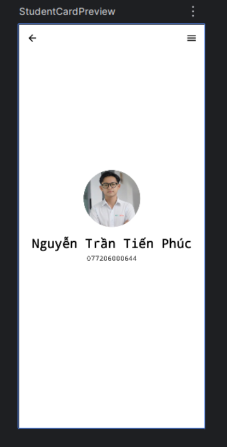

# BÁO CÁO BÀI TẬP TUẦN 1
**Sinh viên:** Nguyễn Trần Tiến Phúc

**MSSV:** 077206000644

## I. Trả lời câu hỏi lý thuyết
**1. Mong muốn và định hướng sau khi học xong môn học:**

Em mong muốn sau khi hoàn thành môn học thì điều đầu tiên là phải nắm vững được các kiến thức lập trình về di động, tiếp đến là các tư duy phát triển và xây dựng một app là như thế nào, các kỹ năng sử dụng AI hợp lý trong công việc. Để từ những điều ấy thì em sẽ mong muốn trong tương lai sẽ tìm kiếm được một cơ hội làm việc với các dự án lập trình di động.

**2. Tương lai gần (10 năm) lập trình di động có phát triển không? Giải thích:**

Theo em trong khoảng 10 năm nữa thì lập trình di động sẽ phát triển cực kỳ mạnh mẽ. Vì trong một thời đại 4.0 thì việc mỗi người đều có cho riêng mình một chiếc điện thoại là điều tất yếu và cũng vì điều đó mà nhu cầu thao tác thông qua điện thoại thông minh lại càng nhiều hơn, từ đó có nhiều các app được ra đời hơn với nhiều tính năng và chức năng tiện lợi hơn có thể phục vụ được nhiều lứa tuổi, nhiều nhu cầu hơn. 

**3. Tìm hiểu mô hình giáo dục HAA:**
Khác với đại học truyền thống, HAA là mô hình giáo dục phi cấp bằng (non-degree), định hướng lợi nhuận, được thiết kế chuyên biệt cho những người trẻ đam mê xây dựng sản phẩm trong kỷ nguyên AI.
* Ưu điểm: Các học viên sẽ được học qua việc thực hành thay vì học các lý thuyết, điều này sẽ giúp cho các học viên tiếp thu và ghi nhớ lâu hơn. Họ sẽ được cấp một lượng tài nguyên khổng lồ (tín dụng điện toán lên tới 50.000 USD), và được kết nối trực tiếp vào mạng lưới các công ty công nghệ hàng đầu (như OpenAI, NVIDIA, Meta) để thực tập hoặc gọi vốn.
* Nhược điểm: Tính rủi ro và độ chọn lọc cực gắt gao, chỉ dành cho một nhóm có thực lực và tham vọng lớn. Việc trường không cấp bằng đại học chính quy có thể trở thành rào cản lớn nếu người học sau này muốn làm việc ngoài lĩnh vực công nghệ hoặc ở các tập đoàn truyền thống. Ngoài ra, mô hình này gắn liền với chu kỳ đầu tư công nghệ, dễ bị ảnh hưởng nếu làn sóng AI hạ nhiệt.

**4. Internet và AI đã làm thay đổi cách con người tiếp cận tri thức như thế nào?**

| Tiêu chí | Trước khi có Internet | Thời kỳ Internet phổ biến | Thời kỳ AI tạo sinh hiện nay |
| :--- | :--- | :--- | :--- |
| **Tìm kiếm** | Thủ công & Chậm chạp: Tra cứu sách vật lý, tài liệu giấy, hỏi trực tiếp giảng viên/chuyên gia. Bị giới hạn bởi không gian. | Bằng Từ khóa (Keywords): Tra cứu qua công cụ tìm kiếm, diễn đàn. Thông tin dồi dào, nhanh nhưng bị phân mảnh ở nhiều nơi. | Bằng Ngôn ngữ tự nhiên (Prompting): Tương tác trực tiếp với AI. AI tự động thu thập, phân tích và tóm tắt thông tin đúng với ngữ cảnh cá nhân hóa ngay lập tức. |
| **Ghi nhớ** | Học thuộc lòng: Bắt buộc nhớ chính xác từng định nghĩa, công thức, cú pháp. Việc tra cứu lại tốn quá nhiều thời gian nên trí nhớ là yếu tố sống còn. | Nhớ cách tìm & nơi tìm: Không cần nhớ tiểu tiết, chỉ cần nhớ dùng từ khóa gì, tìm ở trang web hay tài liệu nào khi cần đến. | Nhớ bản chất & logic: Não bộ được giải phóng khỏi việc nhớ vặt. Tập trung ghi nhớ bản chất của vấn đề, luồng logic (logic flow) và kiến trúc tổng thể. |
| **Vận dụng** | Phụ thuộc hoàn toàn vào lượng kiến thức cá nhân đã tích lũy và lưu trữ sẵn trong não bộ. | Tự thu thập các mảnh ghép từ nhiều nguồn, tự chắt lọc, đánh giá độ tin cậy và tự tay lắp ráp chúng lại để giải quyết vấn đề. | Đóng vai trò Tổng biên tập: Đưa ra ý tưởng, chia nhỏ bài toán để AI thực thi (vd: sinh ra mã code, lên dàn ý). Sau đó dùng tư duy phản biện để kiểm chứng và tối ưu kết quả. |

**5. Chúng ta cần học gì khi AI có thể làm gần như mọi thứ?**

Khi AI đã có thể xử lý tốt các tác vụ chuyên môn chi tiết (viết từng dòng code UI hay tạo các hàm cơ bản), thứ chúng ta cần học không phải là các thao tác rập khuôn, mà là bản chất hệ thống và tư duy giải quyết vấn đề.

Thay vì chỉ học thuộc lòng cú pháp của một ngôn ngữ lập trình, chúng ta cần học về Kiến trúc hệ thống (System Architecture), thiết kế cơ sở dữ liệu, và cách tích hợp để một hệ thống vận hành. Đồng thời, bắt buộc phải học kỹ năng đặt câu hỏi (Prompt Engineering) — biết cách định hình, chia nhỏ và mô tả vấn đề thật rõ ràng để AI có thể hiểu và làm đúng. Cùng với đó là tư duy phản biện để có khả năng kiểm chứng và sửa lỗi những kết quả ảo giác mà AI tạo ra.

**6. Những năng lực nào chúng ta vẫn cần phát triển trong thời đại AI? Vì sao?**

**Năng lực thiết kế và tư duy hệ thống (Systems Thinking)**: AI rất giỏi làm các khối tác vụ cục bộ. Tuy nhiên, để kết nối Front-end, Back-end, Database và các mô hình AI thành một phần mềm hay quy trình hoàn chỉnh thì cần tầm nhìn bao quát của con người. Năng lực này giúp chúng ta không bị thay thế mà trở thành người điều phối AI.

**Năng lực tự chủ và sáng tạo (High Agency)**: Vì AI hoạt động dựa trên dữ liệu của quá khứ. Khả năng tự khởi xướng dự án, nhìn ra những bài toán chưa ai giải quyết trong xã hội và tạo ra các giải pháp đột phá hoàn toàn mới vẫn là điều mà chỉ có bộ não con người mới làm được.

**Trí tuệ cảm xúc (EQ) và Năng lực giao tiếp**: Sự thấu cảm, khả năng làm việc nhóm, truyền cảm hứng và đàm phán là những giá trị mà máy móc vô cảm không có được. Dù hệ thống công nghệ có hiện đại đến đâu, các dự án thực tế cuối cùng vẫn là quá trình con người làm việc với con người.

**Khả năng học tập suốt đời (Lifelong Learning)**: Các framework và công cụ mới ra đời liên tục mỗi tháng. Khả năng thích ứng nhanh, sẵn sàng gạt bỏ kiến thức cũ để nạp kiến thức mới sẽ giúp chúng ta luôn giữ vững vị thế làm chủ công nghệ.

## II. Kết quả thực hành UI
**Bài tập:** Thực hành thiết kế một UI tương tự như bài tập thầy giao 

**Kết quả bài tập:**

**Giải thích các hàm:**

**onCreate()**: Hàm vòng đời cơ bản của Android, tự động được gọi đầu tiên khi ứng dụng (Activity) vừa mở lên để khởi tạo màn hình.

**enableEdgeToEdge():** Hàm thiết lập giao diện tràn viền, cho phép ứng dụng hiển thị đè lên cả khu vực thanh trạng thái (status bar) và thanh điều hướng của điện thoại.

**setContent { ... }:** Hàm đóng vai trò cầu nối, có nhiệm vụ nhúng toàn bộ khối giao diện được viết bằng Jetpack Compose vào màn hình Activity truyền thống.

**StudentCard():** Hàm vẽ giao diện (được gắn nhãn @Composable) do lập trình viên tự định nghĩa, chứa toàn bộ mã nguồn sắp xếp và thiết kế chi tiết thẻ sinh viên.

**StudentCardPreview():** Hàm hỗ trợ chạy thử (được gắn nhãn @Preview), giúp trình biên dịch của Android Studio kết xuất và hiển thị bản xem trước của StudentCard ngay trên màn hình thiết kế mà không cần cài máy ảo.